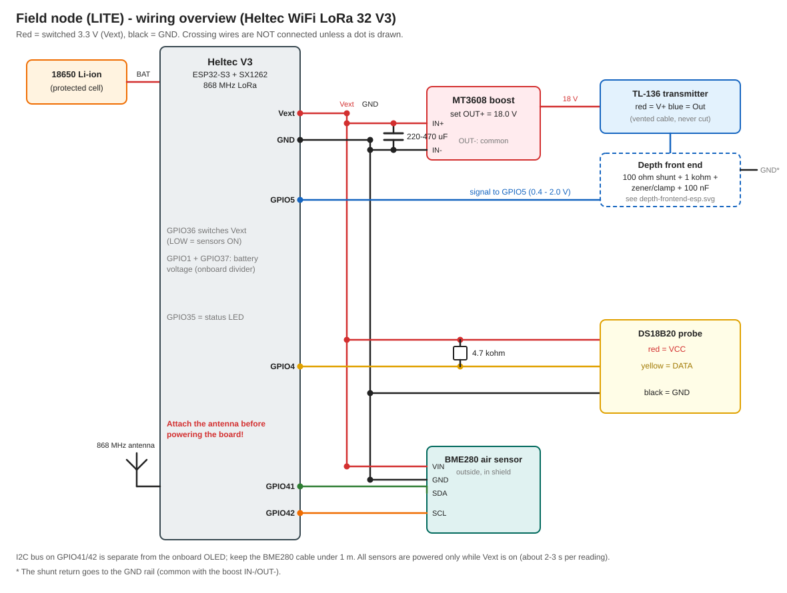

# Groundwater Monitor LITE (ESP32 + LoRa)

> **This is the `lite` branch**: a smaller first step of the project. It measures only
> **water table depth** (TL-136), **groundwater temperature** (DS18B20) and **air temperature + humidity** (BME280).
> No EC sensor, no ADS1115, no air pressure. The full version lives on the `main` branch.

An open-source, low-cost citizen science stack for monitoring groundwater under agricultural land.
Built around the **Heltec WiFi LoRa 32 V3 (ESP32-S3 + SX1262)**: battery-powered field nodes send hourly readings over raw LoRa (868 MHz) to one gateway that feeds **Home Assistant** and the public **openSenseMap** map.

> **Status:** the ESPHome configs pass `esphome config` validation (ESPHome 2026.11) and CI re-checks this on every push. They have **not yet been tested on hardware**. Bench-test one node first (see the Field Deployment Guide).

---

## What it measures

| Quantity | Sensor | Where | Unit |
| :-- | :-- | :-- | :-- |
| Water table depth | TL-136 submersible pressure transmitter (0-5 m, 4-20 mA, vented cable) | in the piezometer | m below ground |
| Groundwater temperature | waterproof DS18B20 | bundled with the TL-136 | °C |
| Air temperature | BME280 | radiation shield next to the well | °C |
| Air humidity | BME280 | radiation shield next to the well | % RH |
| Battery voltage *(diagnostic)* | onboard divider | node | V |

## Key features
* **Long battery life:** the Heltec `Vext` rail (`GPIO36`) cuts power to all sensors between readings. Expect roughly **1-2 years** from one 3000 mAh+ 18650; **measure it** (Field Guide, section 6).
* **Low-battery behaviour:** below 3.4 V a node only reports its battery voltage and sleeps 6 h.
* **Gateway health:** per-well *Node Online* and *Water Below Sensor* entities, and an editable *Sensor Depth Below Ground* (no reflashing when you re-lower a probe).
* **Simple hardware:** one analog channel (depth), one 1-Wire probe, one I²C module. Fewer parts, fewer splices, no calibration fluids.

---

## Repository structure

```text
├── README.md                       # This file
├── BOM.md                          # Shopping list (~€85-105/node)
├── LICENSE                         # MIT
├── .gitignore                      # Excludes secrets.yaml and build caches
├── .github/workflows/
│   └── esphome-validate.yml        # CI: validates all ESPHome configs
├── docs/
│   ├── field-deployment-guide.md   # Splicing, bench test, calibration, install, troubleshooting
│   ├── wiring.md                   # Depth channel, power, BME280, pinout
│   ├── img/                        # Wiring and installation diagrams (SVG)
│   ├── REFERENCES.md               # Sources for technical claims
│   └── CHANGES.md                  # Change log (incl. what lite removed)
├── esphome/
│   ├── secrets.yaml.example        # Template for Wi-Fi, keys & openSenseMap IDs
│   ├── sync-secrets.sh             # Copies secrets.yaml next to every config
│   ├── gateway/
│   │   ├── water-well-gateway.yaml # LoRa receiver + openSenseMap uploader
│   │   └── well-package.yaml       # Everything for ONE well (reused per well)
│   └── nodes/
│       ├── common-well-node.yaml   # Shared node firmware
│       ├── water-well-node-1.yaml  # Node 1 settings & calibration
│       └── water-well-node-2.yaml  # Node 2 settings & calibration
└── home-assistant/
    ├── dashboard-card.yaml         # Lovelace cards for Well 1 and Well 2
    └── README.md
```

---

## Quickstart

### 1. Parts & hardware
* Follow **[`BOM.md`](BOM.md)** (~€85-105 per field node, ~€25 for one gateway).
* Build the depth-channel front end as in **[`docs/wiring.md`](docs/wiring.md)**: **100 Ω shunt**, 1 kΩ series resistor, 3.6 V zener clamp and 100 nF capacitor. The clamp protects the ESP32-S3 if the transmitter fails short onto its 18 V supply.
* Extend and waterproof the DS18B20 cable as in **section 1 of the [Field Deployment Guide](docs/field-deployment-guide.md)**.



#### Heltec V3 pinout

| Component | Pin / wire | Heltec V3 pin | Notes |
| :--- | :--- | :--- | :--- |
| **MT3608 boost input** | `VIN+` / `VIN-` | `Vext` / `GND` | Switched by `GPIO36` (`LOW` = ON). Tune output to **18.0 V**. 220-470 µF low-ESR capacitor across its input. |
| **TL-136 depth probe** | Red (`V+`) / Blue (`Out`) | MT3608 `VOUT+` / shunt node | **100 Ω 0.1 % shunt** from `Out` to `GND`; shunt node through **1 kΩ** to `GPIO5`. |
| **DS18B20 water temp** | Red / Black / Yellow | `Vext` / `GND` / `GPIO4` | **4.7 kΩ pull-up** between `Vext` and `GPIO4`. |
| **BME280 air temp + RH** | `VIN` / `GND` / `SDA` / `SCL` | `Vext` / `GND` / `GPIO41` / `GPIO42` | 3.3 V module, address `0x76` (or `0x77`, set `bme280_address`). In a radiation shield outside the box, cable < 1 m. |

*`GPIO1` reads the battery. The divider is enabled by `GPIO37`: **LOW on V3/V3.1, HIGH on V3.2** (`vbat_ctrl_active_low`, see `docs/wiring.md`). `GPIO35` is the status LED.*

### 2. Register your well on openSenseMap
1. Create a free account at **openSenseMap.org** and click **New senseBox**.
2. Place the marker and add four custom sensors:
   * **Water Table Depth** (unit `m`)
   * **Groundwater Temperature** (unit `°C`)
   * **Air Temperature** (unit `°C`)
   * **Air Humidity** (unit `%`)
3. Copy the **senseBox ID**, the **access token** and the four **sensor IDs**.

### 3. Configure & flash
1. Copy `esphome/secrets.yaml.example` to `esphome/secrets.yaml` and fill it in.
2. Run `esphome/sync-secrets.sh` (ESPHome only reads `secrets.yaml` from the folder of the config it builds).
3. **Gateway:** `esphome run esphome/gateway/water-well-gateway.yaml` on the indoor Heltec V3 via USB-C.
4. **Node:** `esphome run esphome/nodes/water-well-node-1.yaml`. The node sleeps right after each reading: hold **BOOT** while pressing **RST** to re-flash over USB later.

### 4. Calibrate & deploy
Follow the **[Field Deployment Guide](docs/field-deployment-guide.md)**: zero and span the depth channel, compare with a manual dip meter, hang the probes from a dedicated line, measure the installation depth, fit the TL-136 vent tube to a breathable enclosure vent, and mount the BME280 in its shield.

### 5. Home Assistant
1. Adopt `water-well-gateway` under **Settings > Devices & Services > ESPHome** (use the `api_encryption_key`).
2. Paste `home-assistant/dashboard-card.yaml` into a manual card (check the entity IDs first).

---

## Adding more wells
1. Duplicate `esphome/nodes/water-well-node-1.yaml` with a new `node_name`.
2. Add the `well_N_*` entries to `esphome/secrets.yaml`.
3. In `esphome/gateway/water-well-gateway.yaml` add a `wN_*` substitution block, a provider under `packet_transport:` and a package entry under `packages:` (copy the Well 2 lines).

## Upgrading to the full version later
The `main` branch adds an EC/TDS sensor (fertilizer leaching), air pressure and an optional ADS1115 for the depth channel. The lite hardware is a subset: the same board, pins and depth front end, so a lite node can be extended without rewiring (EC goes on `GPIO6`, the ADS1115 on the same I²C bus).

## Sources
See **[`docs/REFERENCES.md`](docs/REFERENCES.md)**.

## Known limitations
* Duty cycle: one frame per hour is about 0.01 % airtime, far below the 1 % limit of the 868.0-868.6 MHz sub-band [R25][R22].
* One transmission per cycle, no acknowledgement: a lost frame is a lost reading (*Node Online* shows longer outages).
* `packet_transport` encryption is a shared passphrase without authentication.
* Depth accuracy with the ESP32 ADC is roughly a few centimetres.
* The BME280 is ±1 °C / ±3 % RH [R24]; without a proper radiation shield the air temperature reads too high in the sun.
